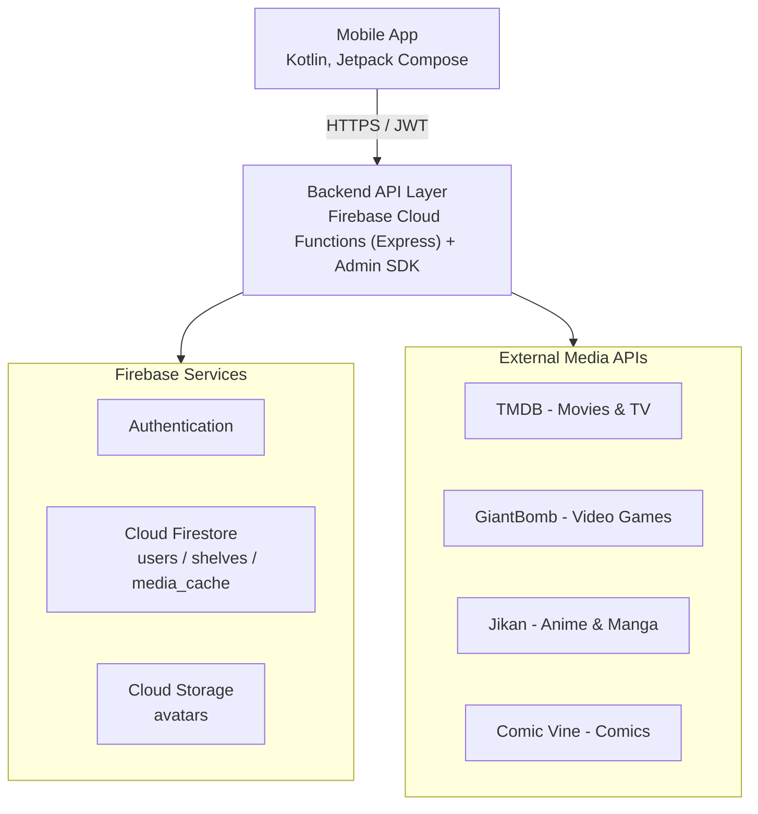

# GeekShelf🥸
**A unified collection tracker for gamers and readers.** 
 
GeekShelf is a mobile-first Android application (Kotlin + Jetpack Compose) that gives users a single place to track their games, comics, manga, anime, movies and TV shows — instead of juggling several single-purpose trackers (e.g. GameTrack, Watchlistfy, Mangayomi).
Figma link: https://www.figma.com/design/j6FQxlp1NqA51QnuGRX3YE/Untitled?node-id=0-1&t=kJS8aHzMYUk720lZ-1 

---

## 📝Table of Contents📝
- [Purpose & Scope](#purpose--scope)
- [Core Features](#core-features)
- [Architecture Overview](#architecture-overview)
- [Structural Design Considerations](#structural-design-considerations)
- [Data Model Summary](#data-model-summary)
- [Backend/Development Stack](#backenddevelopment-stack)
- [Team](#team)

---

## 🚀Purpose & Scope🚀

### GeekShelf's core purpose is to treat a user's own collection as the engine that drives every other feature in the app, rather than treating the library as a static list.

**In scope for v1:**
-  ✅Cross-platform game and media library tracking (games, comics, manga, anime, movies, TV)
-  ✅Linking Steam, PlayStation, Xbox and Crunchyroll accounts to auto-import libraries, playtime and achievement data
-  ✅ A "shelf" visual metaphor for organising the collection, alongside lists, tags and priorities
-  ✅ Offline-first usage with background sync
-  ✅ Real-time push notifications
-  ✅ Multi-language support (English + at least two South African languages)
-  ✅ Secure authentication (SSO + biometric fallback)
-  ✅ Lightweight gamification (badges, streaks, statistics dashboard)
-  ✅ Personalised recommendations and real-time wishlist price alerts

**Explicitly out of scope for v1🚩:** social features, manual entry as a primary flow, price tracking beyond wishlist alerts, user reviews, full media coverage (Anime and Games Databases are down), and limited themes.

## ❇️Core Features❇️

| Feature | Description |
|---|---|
| **Unified Shelf** | A spatial, virtualized shelf view groupable by Status, List, Tag or Platform |
| **Multi-account linking** | OAuth-based linking of Steam, PSN, Xbox and Epic; auto-sync of owned titles and playtime, with deduplication across platforms |
| **Recommendations** | Suggests unowned titles based on genres, series and completion patterns already in the user's library |
| **Wishlist + price alerts** | Real-time notifications when a wishlisted item goes on sale |
| **Gamification** | Completion badges, activity streaks, and a personal stats dashboard |
| **Offline mode** | Status/list/tag edits work offline via Room/SQLite, queued and synced on reconnect (last-write-wins) |

## 🤖Architecture Overview🤖

GeekShelf follows a three-tier architecture: a native Android client, a serverless backend API layer, and a set of managed/external services.

The backend API layer is a thin normalisation and caching layer: it never exposes third-party API keys to the client, and every response — whether it originates from Firestore or from an external API — is returned to the mobile app in one of four standard envelopes (success, paginated collection, error, shelf item).

## 🎨Structural Design Considerations🎨

-  ❇️**Backend-for-Frontend pattern.** The mobile app never talks to TMDB, RAWG, Jikan, AniList or Comic Vine directly. All calls are proxied through the Firebase Cloud Functions layer, which lets the API enforce a single authentication scheme, hide provider API keys, and normalise five very different JSON shapes into one internal `GeekItem` model.
-  ❇️**Cache-first read path.** External media results are persisted into a shared `media_cache` collection keyed by `externalId`, so a second lookup for the same title (by any user) is served from Firestore instead of re-hitting the provider. This is a hard requirement for Comic Vine's 200 requests/hour ceiling and keeps overall API cost down.
-  ❇️**Separation of catalogue data from user data.** `media_cache` (what a title *is*) is fully decoupled from `UserShelfEntry` (what a *user* has done with it — status, progress, rating). This means the same cached title can be referenced by every user's shelf without duplicating catalogue data, and a user's tracking history survives even if the cached catalogue record is refreshed.
-  ❇️**Denormalisation for read performance.** Firestore cannot perform joins, so read-heavy fields (e.g. `type` on `UserShelfEntry`) are duplicated onto the child document rather than requiring a lookup against the parent `media_cache` document on every query.
-  ❇️**Offline-first client state.** Status/list/tag edits are written to a local Room/SQLite store first and queued for sync, so the app remains usable without connectivity; a pending-sync indicator and last-write-wins conflict resolution keep this simple rather than requiring operational-transform style merging.
-  ❇️**Stateless, token-based auth.** Short-lived (15 min) JWT access tokens plus long-lived (7 day) refresh tokens stored in secure HTTP-only cookies keep the API layer stateless and horizontally scalable, with Firestore Security Rules providing a second, defence-in-depth layer of per-user access control alongside backend token verification.
-  ❇️**Consistent envelopes and status codes.** Every endpoint — first-party or external-API-backed — returns the same success/paginated/error/shelf envelope shapes and a documented HTTP status matrix, so client-side parsing logic is uniform regardless of which underlying source served the data.

## 📝Data Model Summary📝

| Collection | Path | Purpose |
|---|---|---|
| `users` | `/users/{uid}` | Account/profile data captured at signup and settings |
| `media_cache` | `/media_cache/{externalId}` | Shared, provider-agnostic cache of catalogue items (`MediaType`: MOVIE / TV / GAME / ANIME / MANGA / COMIC) |
| `media_cache/{id}/issues` | `/media_cache/{volumeId}/issues/{issueId}` | Per-issue data for COMIC-type items |
| `shelves` | `/shelves/{uid}/items/{itemId}` | A user's personal tracking record against a `media_cache` item (status, progress, rating, notes) |
| `proofs` | `/proofs/{paymentId}` | EFT proof-of-payment records for premium upgrades |

Full field-level schemas are documented in Part 1 (Planning and Design) of the POE.

## Backend/Development Stack

-  ⭐**Mobile:** Kotlin, Jetpack Compose, Coil (image loading)
-  ⭐**Backend/API:** Firebase Authentication, Firebase Admin SDK, Cloud Firestore, Firebase Cloud Functions (Node/Express)
-  ⭐**External APIs:** TMDB (movies/TV), RAWG (games), Jikan & AniList (anime/manga), Comic Vine (comics)
-  ⭐**Storage:** Firebase Cloud Storage (avatars)

## 🫱🏻‍🫲🏾Team🫱🏻‍🫲🏾

| Name | Student Number |
|---|---|
| Caleb Peter-John Els | ST10306162 |
| Joshua Kyle Meyer | ST10365670 |
| Olwethu Ruselo | ST10289059 |

Module: PROG7314 · Programme: BCAD0701
